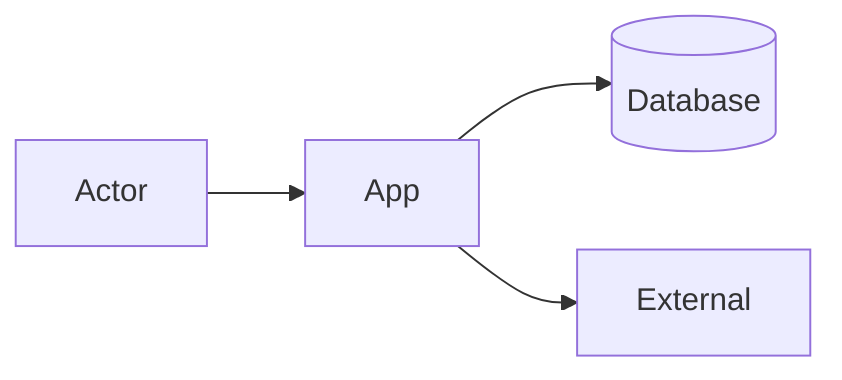

# Architecture section

Use when P0-A triggers. Default when it does not: one deployable, one datastore, synchronous — record that on the Skipped row instead of writing this section.

Prefer a short Mermaid diagram plus the tables. The diagram shows who talks to whom. The tables say what each part owns so Dev does not redraw boundaries.

Emit this section:

## Architecture

### Diagram

### Components
| Component | Responsibility | Does not own |
|-----------|----------------|--------------|
| | | |

### Dependencies
| From | To | Sync or async | Why |
|------|----|---------------|-----|
| | | sync | |

### Deployment boundary
- Deployable units: (e.g. one process)
- Trust boundary: (who is outside the app)
- What is intentionally not split:

### Technology
| Concern | Choice or TBD | Why | Decision |
|---------|---------------|-----|----------|
| Runtime | | | |
| Datastore | | | |
| Messaging | none / TBD | | |

Technology the user did not constrain stays `TBD` plus an owner. Do not pick PostgreSQL, Redis, or a cloud vendor just to fill the cell. A filled choice that is hard to reverse becomes an ADR.

If more than one architecture could satisfy the ACs, compare them in Alternatives and point the chosen row at an ADR. Read `references/architecture-patterns.md` before recommending a split into services.
