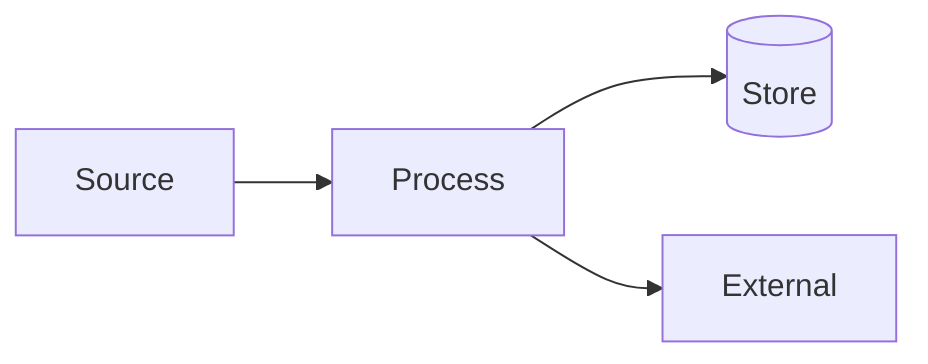

# Data flow section

Use when data crosses a trust or service boundary **and** no sequence diagram already shows the store and the external party. Duplicating SD-1 as a second drawing does not help Dev.

Emit this section:

## Data flow

### DF-1 <name>
Covers: US-…-AC… or Decision D-n

| Step | Data | Owner of the bytes | Persisted? |
|------|------|--------------------|------------|
| | | | yes/no |

- Sensitive fields crossing the boundary:
- What is not copied:

Owner of the bytes is the system allowed to change them. If BA did not name the owner, mark Assumption or ask BA — do not assign ownership silently.
